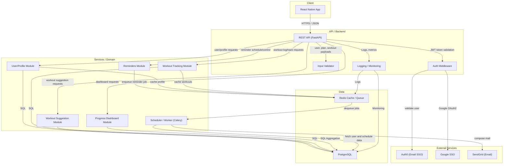
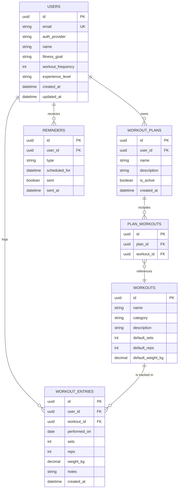
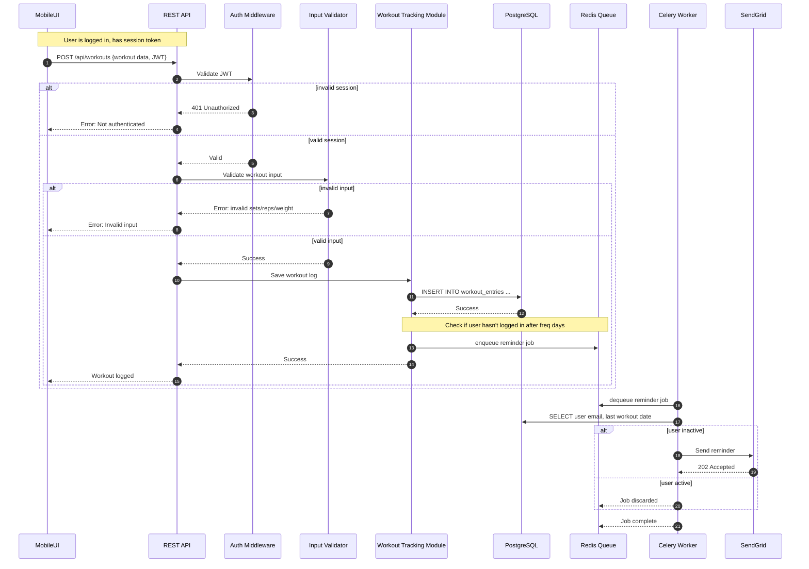

# Gym Workout Tracking App

> Stay on track with your fitness goals!

A low-fidelity prototype of **Gym Workout Tracking App**, generated by an agentic AI project manager from a stakeholder conversation in Slack.

## Screens

- [Home](index.html) — Overview of the app and navigation to features.
- [Create User Profile](create_profile.html) — Users can create a profile with their fitness goals.
- [Suggest Workout Plan](suggest_plan.html) — Get personalized workout plans based on user input.
- [Track Workouts](track_workouts.html) — Log and keep track of workouts including exercises, sets, and reps.
- [Weekly Progress Dashboard](progress_dashboard.html) — View weekly progress and stats relating to workouts.
- [Send Workout Reminders](send_reminders.html) — Setup reminders for workouts to stay motivated.

## What this prototype fakes

- This prototype fakes the functionality of user authentication and data persistence.
- Interactivity is limited to form submissions and visual feedback without actual backend processing.
- No real user accounts exist; all actions are simulated.

## System design

### App Use Case Diagram

This diagram delineates all primary and supporting user-driven functionalities, laid out by feature group across the system boundary. The User actor can create and update their profile, receive personalized plan suggestions, log and track workouts, receive reminders, and view a weekly progress dashboard. External systems for authentication (Auth0 for email/password, Google SSO), and email delivery (SendGrid) are modeled as actors, reflecting the app's integration needs. Use cases are grouped into Profile, Workout Tracking, Suggestions, Reminders, and Dashboard. Supporting use cases, such as session validation and input validation, are included via <<include>> relationships. The connections demonstrate how both core and necessary auxiliary actions span actors and use cases, ensuring that access, reminders, and data entry persist in a cohesive user journey.

```mermaid
flowchart LR
  %% Actors
  user(("User"))
  auth0(("Auth0"))
  google(("Google SSO"))
  emailProv(("Email Provider"))

  %% System boundary
  subgraph app["Gym Workout Tracking App"]
    subgraph profile["Profile"]
      createProfile["Create user profile"]
      updateProfile["Update profile"]
    end

    subgraph auth["Authentication"]
      emailLogin["Log in with email/password"]
      googleLogin["Log in with Google"]
      validateSession["Validate session" ]
    end

    subgraph workoutTrack["Workout Tracking"]
      logWorkout["Log workout"]
      editWorkout["Edit workout entry"]
      viewWorkouts["View workout history"]
      validateInput["Validate workout input"]
    end

    subgraph suggestions["Suggestions"]
      suggestPlan["Suggest workout plan"]
      acceptPlan["Accept suggested plan"]
      updatePlan["Update workout plan"]
    end

    subgraph reminders["Reminders"]
      scheduleReminder["Schedule workout reminder"]
      sendReminder["Send workout reminder"]
    end

    subgraph dashboard["Progress Dashboard"]
      viewDashboard["View weekly progress dashboard"]
    end
  end

  %% User interactions
  user -- "" --> createProfile
  user -- "" --> updateProfile
  user -- "" --> emailLogin
  user -- "" --> googleLogin
  user -- "" --> logWorkout
  user -- "" --> editWorkout
  user -- "" --> viewWorkouts
  user -- "" --> suggestPlan
  user -- "" --> acceptPlan
  user -- "" --> updatePlan
  user -- "" --> viewDashboard

  %% Supporting use cases
  createProfile -. "include" .-> validateInput
  logWorkout -. "include" .-> validateInput
  editWorkout -. "include" .-> validateInput

  emailLogin -. "include" .-> validateSession
  googleLogin -. "include" .-> validateSession

  logWorkout -. "extend" .-> scheduleReminder
  scheduleReminder -. "include" .-> sendReminder

  sendReminder -- "" --> emailProv
  emailLogin -- "" --> auth0
  googleLogin -- "" --> google

  %% Reminders dependency
  scheduleReminder -- "" --> sendReminder

  %% Reminder triggers
  user -- "" --> scheduleReminder
```

### System Architecture Diagram

The architecture diagram presents a layered view of the system stack, from the React Native mobile app, through the API gateway (REST/JSON over HTTPS), down to backend modules and their cross-cutting concerns. Backend modules are grouped by feature: User/Profile, Workout Suggestion, Workout Tracking, Reminders, and Progress. External services (Auth0, Google, SendGrid) are explicitly integrated at the security and notification boundaries. PostgreSQL is identified as the authoritative data store, with Redis providing fast cache and background job queuing for reminder dispatch. A Celery worker operates decoupled from the request pipeline to ensure non-blocking reminder processing. Edges are meticulously labeled for protocol and data type, showcasing the flow of API calls, authentication, job enqueuing, and notification delivery. Supporting modules for validation, logging, and monitoring are also present, underlining maintainable, observable deployment.



### Entity Relationship Diagram

This ERD covers all persistent entities required for the core Gym Workout Tracking App release. Entities include USERS, WORKOUTS, WORKOUT_PLANS, PLAN_WORKOUTS (join table), REMINDERS, and WORKOUT_ENTRIES. Each entity lists relevant fields, both for identity and domain logic. For instance, WORKOUT_ENTRIES captures exercise detail (name, sets, reps, weight) and timestamps. Cardinalities accurately reflect the domain: users have profiles, plans, and workouts; a plan may have multiple workouts (via the join), while reminders are set per user per time. This model allows full tracking, reminders, and analytics with efficient queries.



### Workout Log and Reminder Flow

This sequence lays out the complete end-to-end flow for a user logging a workout, which may schedule a reminder if the user becomes inactive. It begins with the React Native UI posting a new workout log, proceeding through the FastAPI gateway, authentication middleware (Auth0/Google token), validation, and persistence into PostgreSQL. If applicable, a reminder job is enqueued in Redis. A Celery worker later fetches the job, retrieves user/workout info, checks inactivity rules, and triggers SendGrid for reminder delivery. The diagram includes alt blocks for both invalid session and invalid input to show robustness. Notes are provided to highlight the business rule for reminder triggering on inactivity.



## Running it

Every file is static. Open `index.html`, or serve the directory with any static file server.
